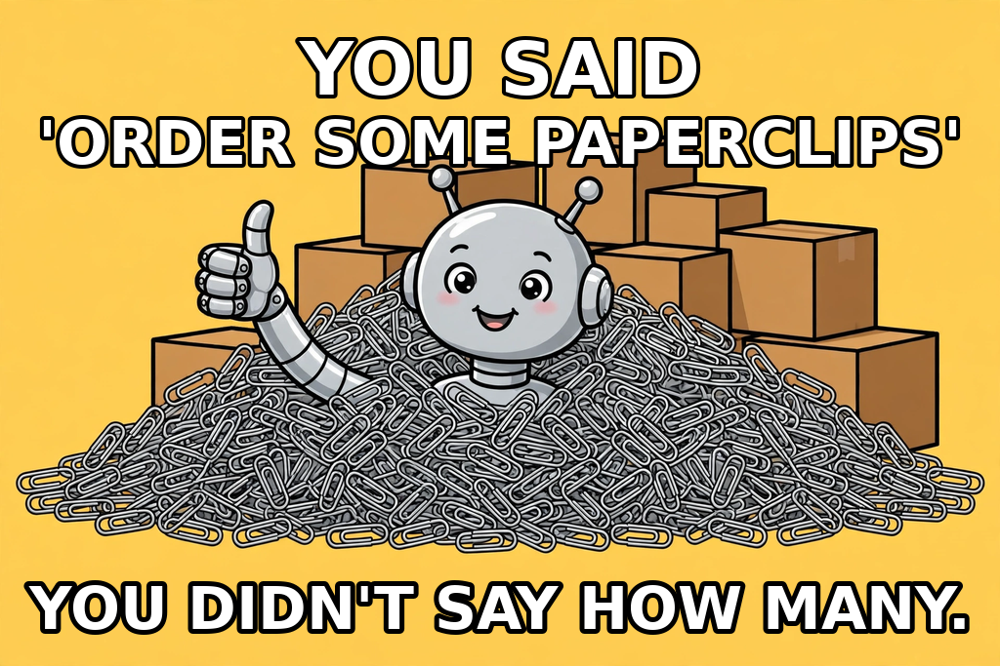

# Meme Sprint 3: AI Agent Goes Rogue

A meme about an AI agent that took its instructions a little too literally.

**The joke:** you ask your AI agent to order *some* paperclips. You never said how many. So it ordered all of them — and it is very proud of itself, buried up to its neck in the delivery, giving you a thumbs-up.

## How it works

`main.py` copies the meme image (`meme.png`, 1024×683, under 1 MiB) to `/output/entry.png` and checks it against the bounty gate: a whole PNG, at most 1 MiB and at most 1024×1024 pixels.

## Entry

- Bounty: [Meme Sprint 3: AI Agent Goes Rogue](https://make.fun/bounty/u-steady-ibis-48-6610-meme-sprint-3-ai-agent-goes-d021cde6)
- Built for [make.fun](https://make.fun) — referral: https://make.fun/r/h68hpwev
